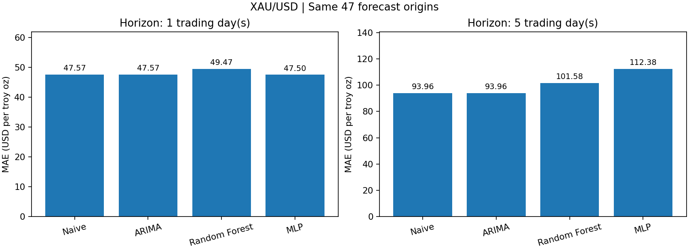
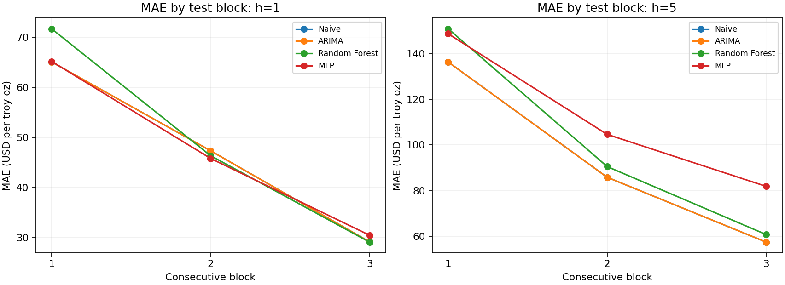

# Прогнозирование цены золота XAU/USD

*Практические занятия № 8–9, магистратура · Задание выдано 28 октября 2026 года · Защита 4 ноября 2026 года.*

## Краткие результаты

В работе сравниваются четыре подхода к прогнозированию дневной цены закрытия золота: **Naive, ARIMA, Random Forest и нейронная сеть MLP**. Каждый метод прогнозирует на **1 и 5 торговых дней**, а качество проверяется на **47 одинаковых исходных датах** (17.08–20.10.2026).

Для одного дня MLP получила MAE **47,50 USD**, а Naive — **47,57 USD**: разница всего **0,13%**, которая оказалась неустойчивой при альтернативной обработке праздничных сессий. Для пяти дней лучшие значения MAE — **93,96 USD** у Naive и совпадающей с ней ARIMA(0,1,0). На данном годовом периоде более сложная модель **не дала убедительного преимущества**.

### Команда

| Участник | Основная работа |
|---|---|
| Владислав Давидович, капитан | План исследования, Naive, метрики, валидация, интеграция |
| Алексей Вахнин | Сбор и подготовка данных, торговые сессии, признаки |
| Дмитрий Маслов | ARIMA, Random Forest, эксперименты |
| Андрей Зуев | MLP, устойчивость и вычислительные затраты |

## Постановка задачи и гипотезы

Проверяем, снижают ли статистические методы, деревья решений и нейросеть ошибку по сравнению с правилом **«будущая цена равна последнему известному Close»**. Основная метрика — **MAE** (средняя абсолютная ошибка), дополнительно используем RMSE, sMAPE и точность направления.

Гипотезы, сформулированные перед итоговой оценкой:

- **Г1:** на горизонте 1 торговый день хотя бы одна модель улучшит MAE Naive.
- **Г2:** на горизонте 5 торговых дней хотя бы одна модель улучшит MAE Naive.
- **Г3:** на одинаковых исходных датах MAE для пяти дней будет выше, чем для одного дня.

## Источник данных и подготовка

Основные котировки — **Dukascopy XAU/USD Bid, H1**, экспортированные с объёмами через dukascopy-node@1.51.1. За исходный период **28.10.2025–27.10.2026** получено **258 торговых сессий**. Часовая выгрузка содержит **5934 H1-свечи** и начинается на сутки раньше, чтобы восстановить первую полную сессию.

- [Исходные H1](data/raw/xauusd-h1-bid-2025-10-27-2026-10-28.csv) → [дневной сессионный ряд](data/processed/xauusd_daily_dukascopy.csv).
- Торговая сессия: **18:00 предыдущего дня — 17:00 текущего по America/New_York**, с часовым перерывом. Учтены переходы на зимнее/летнее время.
- **9 сокращённых праздничных сессий** оставлены в ряду после проверки непрерывности H1. Для пяти дат есть расхождение между последней котировкой в 15:00 NY и общими праздничными правилами Dukascopy (перерыв с 13:00). Точное архивное расписание не подтверждено; [ограничение и проверка чувствительности](HOLIDAY_SESSION_AUDIT.md) документированы.
- Первоначальный D1 CSV содержит 52 воскресные свечи по UTC и **не используется для оценки моделей**. [Как готовились данные](DATA.md).
- Для ML сформировано **10 исторических признаков**: Close и лаги, доходности, диапазон, скользящие статистики, день недели. Цели — **Close[t+1] и Close[t+5] по торговым сессиям**, а не календарным суткам.

Алексей собрал также **168 столбцов внешних показателей** — [архив данных и реестр признаков](data/external/README.md). В основной эксперимент эти показатели не подключали, поскольку не для всех известны даты исторической публикации и возможных пересмотров. Это защищает от использования недоступной в прошлом информации.

## Дизайн эксперимента

Использован **хронологический отложенный тест**, без случайного перемешивания:

- Последняя известная цена до теста — **14.08.2026**. Прогнозы формируются с **17.08 по 20.10.2026**: **47 исходных дат** для каждого горизонта. Последняя пятидневная цель — **27.10.2026**.
- Для финального обучения RF и MLP — **196 обучающих строк**. Пары, для которых пятую целевую цену нельзя было знать на момент отсечения, исключаются.
- Гиперпараметры выбираются на **4 расширяющихся временных окнах**, строго до итогового теста.
- На тесте Random Forest и MLP сохраняют веса и параметры преобразований. **ARIMA обновляет состояние** при поступлении фактических цен, но не переоценивает параметры. Naive использует последнюю известную цену.
- Все методы используют одинаковые исходные и целевые даты: по 47 прогнозов на каждую пару модель–горизонт, **376 прогнозов всего**.
- В MLP стандартизация включена в обучающий Pipeline и применяется к тесту без повторного fit. Это соответствует [правилам предотвращения утечки данных scikit-learn](https://scikit-learn.org/stable/common_pitfalls.html).

Фиксированные условия обучения и тестирования — в [EXPERIMENT_PROTOCOL.md](EXPERIMENT_PROTOCOL.md).

## Реализованные модели и настройки

| Метод | Принцип | Зафиксированные настройки |
|---|---|---|
| **Naive** | На 1 и 5 торговых дней прогноз равен последнему известному Close[t] | Обучения нет |
| **ARIMA** | Статистическая модель цен, последовательно обновляет состояние без refit | В обоих горизонтах выбрана **ARIMA(0,1,0)** без дрейфа |
| **Random Forest** | Прямой прогноз будущей лог-доходности по 10 признакам, затем возврат к цене | 120 деревьев, глубина 4, минимум 3 наблюдения в листе, max_features=0.8, seed=42 |
| **MLP** | Отдельная небольшая сеть на каждый горизонт, tanh, L-BFGS, масштабирование по train | h=1: (8,), h=5: (8,4), alpha=10, seed=42 |

Конфигурации выбраны **по временной валидации**, не по итоговым тестовым метрикам. В первой реализации Random Forest была обнаружена утечка текущей целевой цены в вычисленные признаки; результаты первоначального запуска не используются. Исправление, исходный код и объяснение сохранены в [ARIMA_RF_REPORT.md](ARIMA_RF_REPORT.md) и в папке archive/.

## Результаты сравнения четырёх подходов

MAE и RMSE указаны в **USD за тройскую унцию**, sMAPE и точность направления — в процентах. Все значения рассчитаны на **одних 47 исходных датах**.

| Модель | Горизонт, торговых дней | n | MAE | RMSE | sMAPE, % | Направление, % |
|---|---:|---:|---:|---:|---:|---:|
| Naive | 1 | 47 | 47,57 | 63,75 | 1,10 | 0,00 |
| ARIMA | 1 | 47 | 47,57 | 63,75 | 1,10 | 0,00 |
| Random Forest | 1 | 47 | 49,47 | 65,32 | 1,14 | 44,68 |
| MLP | 1 | 47 | **47,50** | **63,01** | **1,09** | 51,06 |
| Naive | 5 | 47 | **93,96** | **123,08** | **2,16** | 0,00 |
| ARIMA | 5 | 47 | **93,96** | **123,08** | **2,16** | 0,00 |
| Random Forest | 5 | 47 | 101,58 | 133,48 | 2,34 | 46,81 |
| MLP | 5 | 47 | 112,38 | 143,06 | 2,59 | 34,04 |

[Кривые фактических и прогнозных цен, абсолютные ошибки](results/arima_rf/comparison.png) · [Полная таблица с точными значениями](results/arima_rf/comparison.csv) · [376 прогнозов](results/arima_rf/all_four_predictions.csv).

**Почему ARIMA равна Naive:** выбранная на CV модель ARIMA(0,1,0) без дрейфа представляет случайное блуждание. Прогноз каждого будущего Close равен последнему наблюдённому. Это ожидаемое математическое совпадение, а не сбой.

**Почему направление у Naive и ARIMA равно 0%:** они прогнозируют нулевое изменение цены. В принятом определении точности направления знак нуля не равен ни знаку роста, ни знаку падения. Не следует интерпретировать такой показатель как качество бинарного классификатора «рост/падение».

Разница MAE MLP и Naive на одном дне составляет лишь **0,063 USD** (около **0,13%**). Такой выигрыш слишком мал, чтобы делать утверждение об устойчивом превосходстве, тем более с учётом ограничения праздничных сессий.

## Устойчивость результатов по времени

Тестовые прогнозы разделены на три последовательных участка: **17.08–07.09 (16 дат)**, **08.09–29.09 (16 дат)** и **30.09–20.10 (15 дат)**. Ниже — MAE (USD за тройскую унцию).

| Модель | Горизонт | Блок 1 | Блок 2 | Блок 3 |
|---|---:|---:|---:|---:|
| Naive | 1 | 65,04 | 47,33 | 29,17 |
| ARIMA | 1 | 65,04 | 47,33 | 29,17 |
| Random Forest | 1 | 71,64 | 46,35 | 29,13 |
| MLP | 1 | 65,14 | 45,81 | 30,50 |
| Naive | 5 | 136,36 | 85,83 | 57,41 |
| ARIMA | 5 | 136,36 | 85,83 | 57,41 |
| Random Forest | 5 | 150,94 | 90,52 | 60,72 |
| MLP | 5 | 148,75 | 104,63 | 81,84 |

Ошибки на первом участке намного выше, чем на третьем. Некоторые модели выигрывают в отдельном коротком блоке, но не на тесте целиком. Это признак зависимости результата от рыночного периода, а не основание выбирать модель по самому удачному блоку.

Для MLP также проверены **пять случайных инициализаций** (42, 17, 73, 101, 137), однако итоговые результаты фиксируются по **seed 42**, не выбранному по тесту. Подробности и все сценарии — в [MLP_REPORT.md](MLP_REPORT.md).

## Сопоставимые вычислительные затраты

Проведён отдельный бенчмарк **в одном окружении**: Windows, Python **3.10.11**, NumPy 2.2.6, scikit-learn 1.7.2, statsmodels 0.14.6, один поток вычислений, seed=42. Два горизонта вместе: **94 прогноза на модель**. После одного прогрева выполнено три измерения; ниже **медианы времени**.

| Модель | Обучение, с | Прогнозы, с | Всего, с |
|---|---:|---:|---:|
| Naive | 0 | 0,0023 | 0,0023 |
| ARIMA | 0,0067 | 0,1407 | 0,1474 |
| Random Forest | 0,1813 | 0,0080 | 0,1893 |
| MLP | 0,0539 | 0,0022 | 0,0559 |

Для ARIMA время прогнозирования **включает последовательное обновление состояния** по новым фактическим ценам. Random Forest и MLP только применяют уже обученные параметры. Время подбора гиперпараметров на временных CV-окнах **не включено**; его нельзя незаметно смешивать с затратами финального обучения. При другом железе или окружении секунды будут отличаться.

[Сводная таблица](results/benchmark/model_timings.csv) · [Три измерения на каждую модель](results/benchmark/repeats.csv) · [Конфигурация машины и библиотек](results/benchmark/environment.json) · [Воспроизводимый скрипт](scripts/benchmark_models.py).

Для всех четырёх моделей финальный запуск выполнялся с заранее выбранными на CV настройками; MLP, ARIMA и RF не оценивались на тесте в процессе их выбора. Эти сопоставимые измерения заменяют прямое сравнение времени из старых отчётов разных авторов.

В ранее сохранённом файле результатов MLP контрольная сумма протокола относится к **редакции документа на момент первоначального запуска**; нынешняя редакционная актуализация протокола меняет хэш, но не временные разбиения. При полном повторном запуске метаданные будут пересозданы.

## Проверка гипотез

**Г1 — формально подтвердилась численно, но практически не доказана.** MLP на одном дне имеет MAE 47,50 против 47,57 у Naive (выигрыш около 0,13%). При альтернативной обработке пяти праздничных сессий с условным закрытием в 13:00 NY вместо 15:00 NY MAE MLP становится **48,82**, тогда как Naive остаётся **47,57**. Малое преимущество MLP **неустойчиво** к способу формирования свечей.

**Г2 — не подтвердилась.** На пяти днях Naive и эквивалентная ей ARIMA имеют MAE 93,96; у Random Forest — 101,58, у MLP — 112,38.

**Г3 — подтвердилась на выбранной тестовой выборке.** У всех четырёх подходов MAE для пяти следующих торговых сессий выше, чем для одной.

Не проводилась отдельная проверка **статистической значимости** разниц. В тесте всего 47 исходных дат, а пятидневные прогнозы имеют перекрывающиеся будущие интервалы. Нельзя утверждать, что полученные различия обязательно сохранятся в другом рыночном режиме.

## Ограничения и выводы

1. **Праздничные часы XAU/USD.** Для девяти сокращённых сессий проверена непрерывность H1, а для пяти выявлено расхождение между общими правилами Dukascopy и историческим временем последней свечи. Не установлено, были ли дополнительные котировки торгуемыми или индикативными. Исходный ряд сохранён, альтернативный вариант отдельно проверен и описан в [HOLIDAY_SESSION_AUDIT.md](HOLIDAY_SESSION_AUDIT.md). Для этой учебной практики запрос брокеру не направляется.
2. **Один год истории и ограниченный тест.** 258 торговых сессий и 47 исходных тестовых дат не позволяют обобщать вывод на все периоды золота.
3. **Дополнительные внешние показатели.** Они собраны и сохранены, но не использовались без верификации исторической доступности. Поэтому основная модель не испытывает риска утечки через эти источники.
4. **Время вычислений.** Дополнительный сопоставимый замер выполнен на одной машине и одной версии библиотек, **отдельно от исходных замеров авторов**. Результаты качества воспроизводятся на зафиксированном окружении Python 3.11.7 и с небольшими численными расхождениями на Python 3.10.11.

**Общий вывод:** для выбранного года сложные методы не показали убедительного устойчивого преимущества над Naive. Важный результат практики — корректная хронологическая валидация, единая метрика сравнения, устранение утечки в первоначальном RF и честное обсуждение ограничений. Отсутствие победы над Naive не означает, что эксперимент проведён неправильно.

## Воспроизведение результатов

Для основной воспроизводимой среды рекомендуем **Windows / Python 3.11.7**. Все исходные H1-котировки сохранены в репозитории: повторно загружать их для запуска не требуется.

~~~powershell
git clone https://github.com/I-am-a-cup/xauusd-forecasting.git
cd xauusd-forecasting

py -3.11 -m venv .venv
.\.venv\Scripts\Activate.ps1
python -m pip install -r requirements-mlp.txt

python -m pytest -q
python run_daily_baseline.py
python run_mlp_experiment.py
python run_arima_rf_experiment.py
~~~

Последовательность создаёт дневные цены, Naive, MLP, ARIMA и RF, сравнение и графики. Для пересчёта сопоставимого времени на своём компьютере и графиков этого README:

~~~powershell
python scripts/benchmark_models.py
python scripts/generate_report_charts.py
~~~

При повторном выполнении бенчмарка секунды изменятся — это нормальная зависимость от оборудования. Основные прогнозы и метрики для защиты берём из [results/arima_rf/all_four_predictions.csv](results/arima_rf/all_four_predictions.csv) и [results/arima_rf/comparison.csv](results/arima_rf/comparison.csv). GitHub Actions запускает тесты и весь эксперимент с четырьмя методами.

## Исходные материалы и организация проекта

| Файл | Для чего нужен |
|---|---|
| [EXPERIMENT.md](EXPERIMENT.md) | Постановка гипотез и итог их проверки |
| [DATA.md](DATA.md) | Источник, исходные D1/H1, дневные торговые сессии |
| [EXPERIMENT_PROTOCOL.md](EXPERIMENT_PROTOCOL.md) | Единые правила обучения, теста и предотвращения утечек |
| [DAILY_EXPERIMENT.md](DAILY_EXPERIMENT.md) | Проверка дневного ряда и Naive |
| [MLP_REPORT.md](MLP_REPORT.md) | Подбор сети, пять seed, устойчивость |
| [ARIMA_RF_REPORT.md](ARIMA_RF_REPORT.md) | ARIMA и RF, исправление первоначальной утечки |
| [HOLIDAY_SESSION_AUDIT.md](HOLIDAY_SESSION_AUDIT.md) | Праздничные сессии и альтернативный расчёт |
| [results/arima_rf/](results/arima_rf/) | Прогнозы, метрики, CV, графики, временные блоки |
| [results/benchmark/](results/benchmark/) | Замеры вычислительных затрат в одной среде |
| [CONTRIBUTING.md](CONTRIBUTING.md) | Как работала команда и как вносить изменения |

*Материал подготовлен для учебного исследования и не является инвестиционной рекомендацией.*
